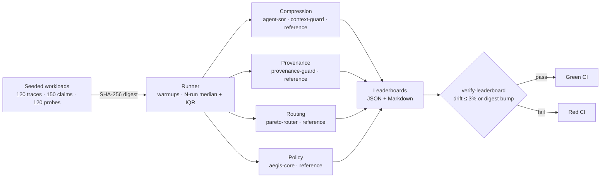

# agent-benchmark-suite

**One command. Five flagship agent libraries. Reproducible leaderboards.**

A unified benchmark harness that measures what agentic-AI libraries actually
claim — token compression, provenance catch-rate, routing Pareto coordinates,
and zero-trust policy enforcement — against **seeded, SHA-256-digested
workloads**, with **CI-enforced drift checks (≤ 3%)** so committed numbers can
never silently rot.



## Benchmarked flagships

| Library | Capability | Adapter |
| :--- | :--- | :--- |
| [`agent-snr`](https://github.com/Sandeep-Hipparagi/agent-snr) | SNR-gated context firewall | `AgentSNRCompressionAdapter` (in-process) |
| [`context-guard`](https://github.com/Sandeep-Hipparagi/context-guard) | State-ledger context compression | `ContextGuardCompressionAdapter` (in-process) |
| [`epistemic-guard`](https://github.com/Sandeep-Hipparagi/epistemic-guard) (`provenance-guard` on PyPI) | Deterministic source tiering | `ProvenanceGuardAdapter` (in-process) |
| [`Inference-Pareto-Router`](https://github.com/Sandeep-Hipparagi/Inference-Pareto-Router) | 2D cost/quality Pareto routing | `ParetoRouterAdapter` (in-process) |
| [`aegis-core`](https://github.com/Sandeep-Hipparagi/aegis-core) | Zero-trust schema/policy gate | `AegisCoreAdapter` (Node subprocess on built dist) |

Every capability also ships a **reference adapter** — a real, deterministic
in-process engine that executes the same algorithmic contract (it computes
genuine ratios, precision/recall, and gate decisions per item; nothing is
hardcoded). Native adapters are wired via optional extras and report
themselves honestly unavailable when the flagship library is not installed —
they never fabricate results.

## Baseline leaderboards (generated, CI-verified)

Run with `--seed 42`, 120 traces / 150 claims / 120 probes, reference mode.
Full tables: [`benchmarks/leaderboards/LEADERBOARD.md`](benchmarks/leaderboards/LEADERBOARD.md).

### compress — 46.8% of corpus tokens eliminated

| Adapter | Implementation | Tokens before | Tokens after | Compression ratio | Keyword retention |
| :--- | :--- | ---: | ---: | ---: | ---: |
| `reference-compactor` | reference | 21428 | 11406 | 0.467706 | 0.658513 |

### provenance — 150 claims, tiers 1–5, 30% TLD-fallback URLs

| Adapter | Implementation | Precision (citable) | Recall (citable) | Exact-tier accuracy | Tier MAE |
| :--- | :--- | ---: | ---: | ---: | ---: |
| `reference-tierer` | reference | 1.0 | 1.0 | 1.0 | 0.0 |

### route — 120 Pareto decisions across 3 strategy presets

| Adapter | Implementation | Tier distribution | Mean effort score |
| :--- | :--- | :--- | ---: |
| `reference-pareto` | reference | FRONTIER 30 · MID 62 · COMPACT 28 | 0.406958 |

### policy — 120 probes (50% adversarial)

| Adapter | Implementation | Bypass resistance | Benign pass rate |
| :--- | :--- | ---: | ---: |
| `reference-policy-gate` | reference | 1.0 | 1.0 |

Latency medians are measured every run and reported in the JSON leaderboards,
but are intentionally **excluded from drift verification** — they are
environment-specific. Functional metrics are byte-deterministic per workload
digest.

## Quickstart

```bash
pip install -e .[dev]

# 1. Run every suite and write JSON + Markdown leaderboards
agent-bench run --suite all

# 2. Verify a committed leaderboard against a fresh deterministic run
agent-bench verify-leaderboard benchmarks/leaderboards/compress.json

# 3. CI mode: run + self-verify drift in one step (fails the build on drift)
agent-bench run --suite all --check-drift
```

Run the *real flagship libraries* natively (in-process Python, Node subprocess
for aegis-core):

```bash
pip install -e .[native]
agent-bench run --suite all --mode native
```

The aegis-core native adapter additionally requires Node.js and a built
checkout: `AEGIS_CORE_PATH=/path/to/aegis-core` (with `dist/core/src/index.js`
present). Without it the adapter reports unavailable and is skipped — with an
honest implementation column in the leaderboard, never a fabricated row.

## How reproducibility is enforced

1. **Workload digests** — every suite hashes its full corpus (canonical JSON,
   SHA-256) into the leaderboard. Example:
   `compress@42390cd9…`, `provenance@d56bd825…`, `policy@28fce33e…`.
2. **Drift gate** — `verify-leaderboard` re-runs the suite and compares every
   functional metric; drift > 3% fails CI.
3. **Digest bumps are explicit** — changing a workload without bumping the
   digest fails; the committed JSON must acknowledge `digest_bumped: true`.
4. **Determinism** — generators are pure functions of their seed; no wall
   clock, no unseeded randomness, no network in scoring paths.

## Development

```bash
ruff check . && ruff format --check .   # lint + format
mypy --strict src tests                 # full strict typing
pytest                                  # 85 tests
agent-bench verify-leaderboard benchmarks/leaderboards/policy.json
```

See [CONTRIBUTING.md](.github/CONTRIBUTING.md) for adapter guidelines and
[SECURITY.md](.github/SECURITY.md) for reporting policy.

## License

MIT — see [LICENSE](LICENSE).
